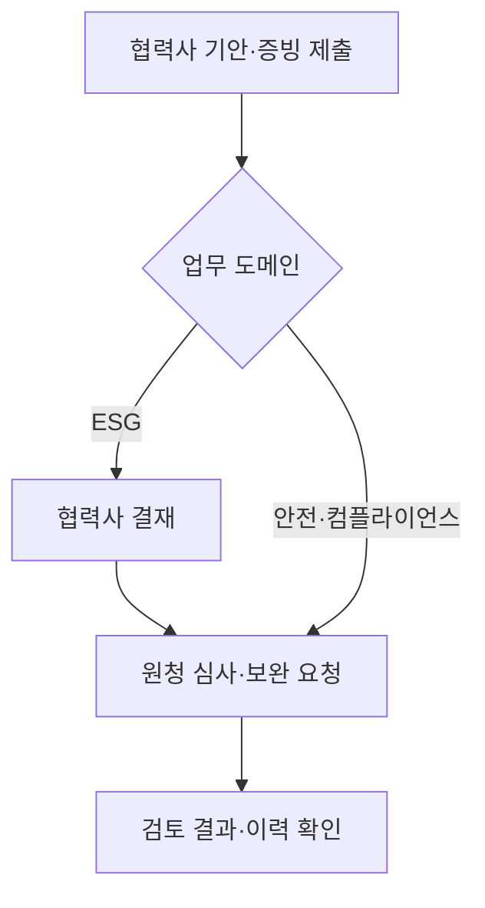

# SmartChain Backend

[](https://github.com/withoutsultang/SmartChain_Backend/actions/workflows/portfolio-checks.yml)

[](https://github.com/withoutsultang/SmartChain_Backend/actions/workflows/authorization-audit.yml)

> 회사·도메인 권한과 업무 상태를 연결하고, AI 분석 결과를 실제 검토 업무로 전달하는 Spring Boot 백엔드

**KT AIVLE School 빅프로젝트 · 7인 팀 · 최우수상(2위)**

협력사의 증빙 제출부터 검토·승인·보완 요청까지 연결하는 **AI 기반 공급망 리스크 관리 플랫폼**입니다. ESG·안전보건·하도급 컴플라이언스의 세 업무 영역을 하나의 제출·검토 흐름으로 구성했습니다.

## 실제 서비스 시연


**기안 생성 → 증빙 9개 업로드·분류 → 실제 AI 분석 → 회사 결재 → 원청 심사·보완 요청 → 최종 승인**을 연결했습니다. 합성 문서로 실제 서비스를 실행해 캡처한 15.4초 시연입니다.

[화면 7개 보기](https://github.com/withoutsultang/SmartChain_Frontend/tree/develop/docs/demo) · [실행 결과와 검증 근거](https://github.com/withoutsultang/SmartChain_AI/blob/main/docs/verification.md)

## 김건우의 주요 기여

팀이 합의한 기능 명세를 기준으로 Claude Code를 활용해 구현하고, 내부 테스트와 팀 QA를 통해 업무 흐름을 확인했습니다. 담당 영역은 **업무 API·AI 연동·권한 검증·상태 흐름·예외 계약·테스트·공통 개발 문서**입니다.

|구현 사례|기술적 접근|근거|
|---|---|---|
|회사·도메인별 결재 권한|회사 조건과 도메인 APPROVER 역할을 함께 검사하고 목록·통계·처리 경로에 적용|[PR #33](https://github.com/SmartChain-HD/Backend/pull/33)|
|세 도메인 공통 AI 연동|WebClient 기반 Preview/Submit 클라이언트와 분석 결과·이력 저장/조회 API|[PR #40](https://github.com/SmartChain-HD/Backend/pull/40)|
|원청 제출과 심사 데이터 연결|상태 변경에 Review 저장·연결 정보·실제 reviewId 반환을 연결|[PR #179](https://github.com/SmartChain-HD/Backend/pull/179)|
|AI 요청의 대기 시간 분리|Preview 전용 30초 타임아웃·1회 재시도 및 오류 응답 구성|[PR #212](https://github.com/SmartChain-HD/Backend/pull/212)|
|긴 AI 보완 사유 처리|DDL·DTO의 2,000자 정책과 입력 검증·경계 사례 보강|[PR #222](https://github.com/SmartChain-HD/Backend/pull/222)|
|교차검증 결과의 업무 모델링|일반 슬롯과 비교 결과를 분리한 DTO와 표시명 매핑|[PR #231](https://github.com/SmartChain-HD/Backend/pull/231)|

## 업무 흐름



## 실행으로 확인한 신뢰성

2026-10-29 재검증에서 전체 테스트 **485개 통과·1개 건너뜀**, `clean build` 성공을 확인했습니다. 로그인 실패마다 별도 HTTP 요청과 PostgreSQL 조회를 실행해 **실패 횟수 누적·5회 잠금·잠금 중 로그인 거절**을 검증했습니다. 실제 AI 분석 결과의 저장과 결재·Review 생성·보완 요청·최종 승인 이력까지 확인했습니다.

AI의 **5개 경로에도 회사·도메인·기안 소유권 정책을 일관되게 적용**하고, 다른 기안의 파일 ID 혼용을 차단했습니다. PostgreSQL의 실제 HTTP 권한 검사 **42개**로 정상 접근 유지와 비동기 분석 등록 전 차단을 확인했습니다. [권한 검증 근거](docs/ai-authorization-verification.md)

[테스트·실행 근거](https://github.com/withoutsultang/SmartChain_AI/blob/main/docs/verification.md)

## 기술 구성

Java 17 · Spring Boot 3.5 · Spring Security/JWT · Spring Data JPA · PostgreSQL · WebClient · JUnit/MockMvc

- **업무 모델**: 회사·도메인·진단·결재·심사·이력으로 제출과 검토 책임을 표현합니다.
- **AI 계약**: 파일 분류용 Preview와 전체 검증용 Submit을 나누고 결과를 업무 DTO에 연결합니다.
- **검증**: 서비스 단위 시험, JWT 기반 MockMvc 통합 시험, 상태·예외·연결 데이터 시험을 구성했습니다.
- **협업**: API 명세·CLAUDE.md·Issue 단위 PR·트러블슈팅 기록으로 AI 보조 개발 기준을 공유했습니다.

## 로컬 실행

Java 17과 PostgreSQL 15를 준비합니다. 기본 로컬 DB 설정은 `src/main/resources/application.yaml`, 컨테이너 DB는 `docker-compose.yml`을 참고하세요. AI 서비스는 8000/8001/8002 포트로 연결합니다.

```bash
docker compose up -d
./gradlew bootRun
# API 문서: http://localhost:8080/swagger-ui/index.html
./gradlew test
./gradlew test --tests '*LoginFailurePersistenceTest'
```

## 코드 탐색

- `src/main/java/.../domain/approval`: 회사·도메인 결재 검증과 원청 제출
- `src/main/java/.../domain/ai`: 공통 AI 클라이언트·분석 결과
- `src/main/java/.../domain/review`: 심사·보완 요청과 결과 DTO
- `src/test/java`: 서비스·API 통합 시험
- `docs/ERD.md`, `docs/API_CONTRACT_SSOT.md`: 데이터 모델과 API 계약

검증 자동화는 **Actions → Portfolio checks → Run workflow**에서 실행할 수 있습니다.

## 프로젝트 저장소

[Backend](https://github.com/withoutsultang/SmartChain_Backend) · [Frontend](https://github.com/withoutsultang/SmartChain_Frontend) · [AI](https://github.com/withoutsultang/SmartChain_AI)

팀 원본: [SmartChain-HD](https://github.com/SmartChain-HD). 이 저장소는 팀 프로젝트의 개인 포트폴리오용 포크이며 위 기여는 김건우가 제출한 변경을 중심으로 정리했습니다.
